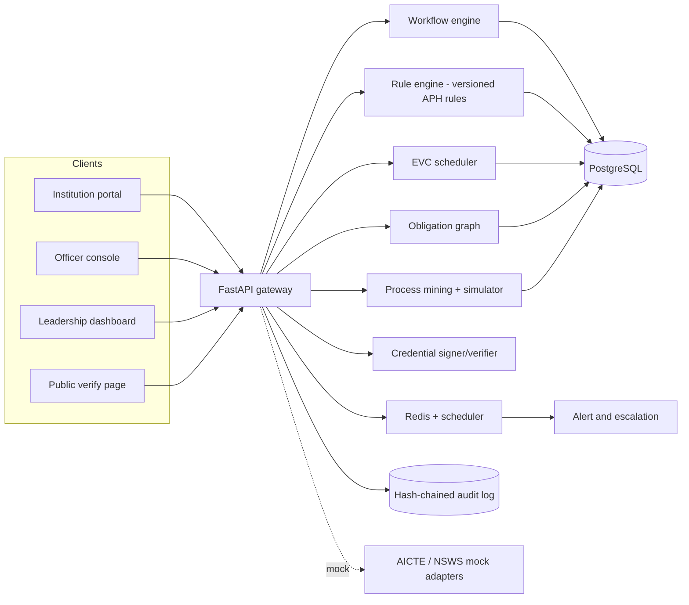

# ApprovalIQ — Explainable Approval, Compliance & Capacity Intelligence for AICTE

> **Smart India Hackathon 2026 · Problem Statement SIH26262** (AICTE · Software · Smart Automation)
> *Integrated AICTE Approval Workflow Automation, Compliance Monitoring and Alert Management System*

**Team:** `[TEAM NAME]` · **Institute:** `[COLLEGE]` · **Members:** `[NAMES + ROLES]`
**Demo video:** `[LINK]` · **Live demo:** `[LINK]` · **Slides:** `[LINK]`

> **Read this first (honest scope).** ApprovalIQ is a **decision-support prototype**. It never approves or rejects an application; AICTE officers do. All data is **synthetic**. There is **no integration** with the real AICTE portal, NSWS, banks, DigiLocker or APAAR. Every adapter to those systems is a labelled **mock**. Stage names, SLA values and escalation timings are **configurable placeholders**, not official AICTE values, unless a clause reference says otherwise.

---

## 1. The problem in one paragraph
AICTE approves and extends approval for thousands of technical institutions each cycle. An application moves through scrutiny, re-scrutiny, Expert Visit Committee (EVC) inspection, committee decisions and finally a Letter of Approval, Deficiency or Rejection, with undertakings, affidavits and time-bound documents along the way. Tracking pendency, scheduling expert visits, watching undertakings and expiries, and escalating delays is largely manual and fragmented across regions and officers. Details: [docs/PROBLEM_STATEMENT.md](docs/PROBLEM_STATEMENT.md).

## 2. Our solution
ApprovalIQ combines three layers:
1. **Reliable core** — a configurable workflow engine, an APH clause-cited rule engine, SLA/pendency tracking, EVC scheduling with conflict-of-interest checks, undertaking and document-validity tracking, alerts and escalation, and a tamper-evident audit trail.
2. **Process intelligence** — process mining that compares every case with the prescribed route and finds real bottlenecks.
3. **Leadership intelligence** — a capacity **what-if simulator** and an institution **obligation graph** showing which approvals are at risk when something expires.

Details: [docs/SOLUTION_OVERVIEW.md](docs/SOLUTION_OVERVIEW.md).

## 3. What makes it different
Many teams build workflow + SLA + rule engine + audit chain. We treat those as **table stakes** (done well, with clause references and tests) and differentiate on:

| # | Differentiator | Why it matters |
|---|---|---|
| D1 | **Process-mining conformance & bottleneck root cause** | Shows where and why cases actually stall, versus the prescribed route |
| D2 | **Capacity what-if simulator** | Lets leadership test officer allocation / SLA changes before acting |
| D3 | **Verifiable approval credential + public check page** | Anyone can verify a signed approval record (demo keys only) |
| D4 | **Institution obligation graph** | Explains which approvals are at risk when a lease, NOC or undertaking lapses |
| D5 | **Explainability everywhere** | Every flag cites a rule, version and (where verified) APH clause |

Details and evidence plan: [docs/FEATURES.md](docs/FEATURES.md). *We have not claimed any of D1–D5 is unique to us; see [docs/LIMITATIONS_AND_RISKS.md](docs/LIMITATIONS_AND_RISKS.md).*

## 4. Existing systems and our improvement
Summary (competitor / landscape re-check log in [docs/PROJECT_AUDIT.md](docs/PROJECT_AUDIT.md)):

| Existing | What it does | Gap we address |
|---|---|---|
| AICTE web portal | Online application, approval reports with deficiencies | Pendency analytics, simulation, explainable rule citations *(to validate)* |
| NSWS | Single window for new institutions | Unified tracking across NSWS and AICTE portal *(mock adapter)* |
| CPGRAMS-style generic tools | Generic workflow / grievance tracking | Not encoded with APH stages and norms |

## 5. Architecture at a glance

Full architecture: [docs/SYSTEM_ARCHITECTURE.md](docs/SYSTEM_ARCHITECTURE.md).

## 6. Tech stack
React + TypeScript · FastAPI (Python 3.12) · PostgreSQL · Redis · pm4py (process mining) · OR-Tools CP-SAT (EVC scheduling) · SimPy (simulation) · Tesseract/PaddleOCR (optional extraction) · pyHanko / cryptography (signing) · Docker Compose. *Final choices must match what is actually built.*

## 7. Repository structure
See [docs/PROJECT_STRUCTURE.md](docs/PROJECT_STRUCTURE.md).

## 8. Quick start *(update to match the real repo)*
```bash
git clone <repo-url> && cd sih26262
cp .env.example .env            # fill values, never commit secrets
docker compose up --build       # API :8000, web :5173
python backend/scripts/seed.py  # synthetic data only
```
Demo logins are listed in [docs/DEMO_SCRIPT.md](docs/DEMO_SCRIPT.md).

## 9. Demo
Five-scene demo (normal, deficiency, intelligent detection, simulation, tamper test): [docs/DEMO_SCRIPT.md](docs/DEMO_SCRIPT.md).

## 10. Testing
Unit, integration, rule gold-set and performance checks: [docs/TESTING_STRATEGY.md](docs/TESTING_STRATEGY.md). Results table is filled **only with measured numbers**.

## 11. Roadmap
MVP → Advanced → Production: [docs/ROADMAP.md](docs/ROADMAP.md).

## 12. Documentation index
| Doc | Purpose |
|---|---|
| [EXECUTIVE_SUMMARY](docs/EXECUTIVE_SUMMARY.md) | One-page overview |
| [PROBLEM_STATEMENT](docs/PROBLEM_STATEMENT.md) | Problem, users, impact |
| [SOLUTION_OVERVIEW](docs/SOLUTION_OVERVIEW.md) | Solution design and layers |
| [FEATURES](docs/FEATURES.md) | Features C1–C9 and differentiators D1–D5 |
| [UNIQUE_INNOVATION](docs/UNIQUE_INNOVATION.md) | What is different, and what we do not claim |
| [USE_CASES](docs/USE_CASES.md) | Actor flows |
| [REQUIREMENTS](docs/REQUIREMENTS.md) | Functional and non-functional requirements |
| [SYSTEM_ARCHITECTURE](docs/SYSTEM_ARCHITECTURE.md) | Components and diagrams |
| [ARCHITECTURE_DECISIONS](docs/ARCHITECTURE_DECISIONS.md) | ADRs |
| [DATA_FLOW](docs/DATA_FLOW.md) | Lifecycle and data stores |
| [TECH_STACK](docs/TECH_STACK.md) | Technology choices |
| [PROJECT_STRUCTURE](docs/PROJECT_STRUCTURE.md) | Folder layout |
| [DATABASE_SCHEMA](docs/DATABASE_SCHEMA.md) | Data model + starter DDL |
| [API_REFERENCE](docs/API_REFERENCE.md) | API contract |
| [ALERT_SCHEMA](docs/ALERT_SCHEMA.md) | Alert fields, dedupe, rules |
| [CONFIGURATION](docs/CONFIGURATION.md) | Env vars and config tables |
| [MODULE_DESIGN](docs/MODULE_DESIGN.md) | Common module contract |
| [modules/](docs/modules/) | One doc per engine (workflow, rules, SLA, EVC, undertakings, alerts, audit, mining, simulator, credentials, obligations) |
| [ML_METHODOLOGY](docs/ML_METHODOLOGY.md) | Algorithms and evaluation plan |
| [DATASETS](docs/DATASETS.md) | Synthetic data and seeded defects |
| [IMPLEMENTATION_GUIDE](docs/IMPLEMENTATION_GUIDE.md) | **Step-by-step build order** |
| [DEPLOYMENT](docs/DEPLOYMENT.md) | Docker Compose and hosting |
| [SECURITY_AND_ISOLATION](docs/SECURITY_AND_ISOLATION.md) | Controls and isolation model |
| [THREAT_MODEL](docs/THREAT_MODEL.md) | STRIDE table |
| [TESTING_STRATEGY](docs/TESTING_STRATEGY.md) | Test plan and invariants |
| [experiments/](docs/experiments/) | Reproducible evaluation protocols |
| [PERFORMANCE_BENCHMARK](docs/PERFORMANCE_BENCHMARK.md) | Benchmark method (no numbers until measured) |
| [RESULTS](docs/RESULTS.md) | Measured results only |
| [COMPLETENESS_REPORT](docs/COMPLETENESS_REPORT.md) | Honest feature status |
| [PROJECT_AUDIT](docs/PROJECT_AUDIT.md) | Self-audit and competitor re-check log |
| [LIMITATIONS_AND_RISKS](docs/LIMITATIONS_AND_RISKS.md) | Honest limits and risk register |
| [ROADMAP](docs/ROADMAP.md) | MVP → Advanced → Production |
| [DEMO_SCRIPT](docs/DEMO_SCRIPT.md) | Demo scenario |
| [FAQ_AND_JUDGE_QA](docs/FAQ_AND_JUDGE_QA.md) | Jury Q&A |
| [PPT_CONTENT](docs/PPT_CONTENT.md) | Slide content |
| [SUBMISSION_CHECKLIST](docs/SUBMISSION_CHECKLIST.md) | Pre-submission checklist |
| [GLOSSARY](docs/GLOSSARY.md) | Terms |
| [TROUBLESHOOTING](docs/TROUBLESHOOTING.md) | Common problems |
| [REFERENCES](docs/REFERENCES.md) | Sources |
| [rulesets/…/CLAUSE_MAP](rulesets/aph-2024-27/CLAUSE_MAP.md) | Rule ↔ APH clause map |

## 13. License & acknowledgements
`[CHOOSE LICENSE, e.g. MIT]`. Built for SIH 2026 (Ministry of Education's Innovation Cell & AICTE). Synthetic data only.
