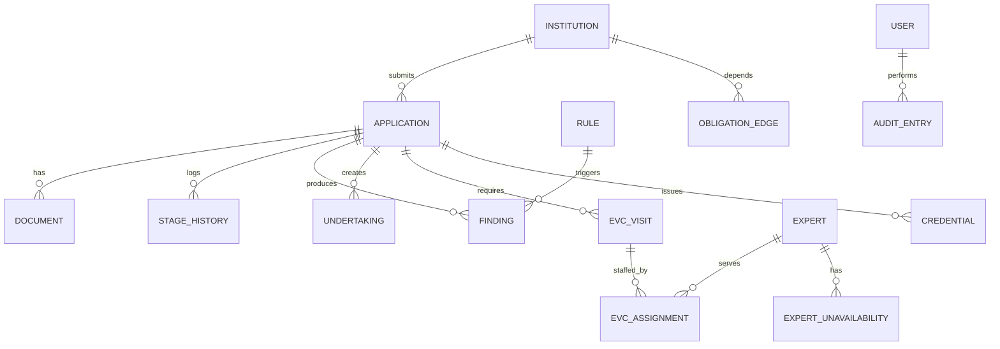

# Database Schema (PostgreSQL)

## ER overview


## Tables
| Table | Key fields | Notes |
|---|---|---|
| institutions | id, name, region, state, type | synthetic |
| users | id, email, password_hash, role, region, institution_id | roles: institution, officer, evc_member, regional_head, national_head, auditor, admin |
| workflow_stages | code, order, sla_days, owner_role, next_stages | config |
| applications | id, institution_id, category, stage, owner_id, priority, decision | one open stage row enforced |
| stage_history | application_id, stage, entered_at, due_at, exited_at, outcome | event log for mining |
| documents | id, application_id, type, storage_path, sha256, valid_until | private storage path only |
| extracted_fields | document_id, key, value, confidence | OCR output |
| rules | id, version, clause_ref, severity, logic_json, status (ASSUMED/VERIFIED) | never edited in place |
| findings | application_id, rule_id, rule_version, evidence_json, state | officer accepts / dismisses with reason |
| experts, expert_unavailability | region, expertise, load | scheduler inputs |
| evc_visits, evc_assignments | application_id, date, status | PROPOSED / CONFIRMED / COMPLETED / CANCELLED |
| undertakings | application_id, due_date, status | PENDING / SUBMITTED / VERIFIED / OVERDUE / WAIVED |
| alerts | entity, rule_code, level, dedupe_key (unique) | idempotent |
| obligation_edges | from_type, from_id, to_type, to_id, kind | dependency graph |
| credentials | application_id, payload, signature, status | revocable |
| audit_entries | id, actor, action, entity, payload_hash, prev_hash, hash | append-only |

## Reference DDL (starter — adapt, then turn into numbered migrations)
```sql
-- 001_foundation.sql
CREATE TABLE institutions (
  id BIGSERIAL PRIMARY KEY,
  name TEXT NOT NULL,
  region TEXT NOT NULL,
  state TEXT NOT NULL,
  type TEXT NOT NULL
);

CREATE TABLE users (
  id BIGSERIAL PRIMARY KEY,
  email TEXT UNIQUE NOT NULL,
  password_hash TEXT NOT NULL,
  role TEXT NOT NULL CHECK (role IN
    ('institution','officer','evc_member','regional_head','national_head','auditor','admin')),
  region TEXT,
  institution_id BIGINT REFERENCES institutions(id)
);

CREATE TABLE workflow_stages (
  code TEXT PRIMARY KEY,
  stage_order INT NOT NULL,
  sla_days INT NOT NULL,            -- placeholder, configurable
  owner_role TEXT NOT NULL,
  next_stages TEXT[] NOT NULL DEFAULT '{}'
);

CREATE TABLE applications (
  id BIGSERIAL PRIMARY KEY,
  institution_id BIGINT NOT NULL REFERENCES institutions(id),
  category TEXT NOT NULL,
  stage TEXT NOT NULL REFERENCES workflow_stages(code),
  owner_id BIGINT REFERENCES users(id),
  priority NUMERIC(6,2) NOT NULL DEFAULT 0,
  decision TEXT,                    -- set only by a human decision action
  created_at TIMESTAMPTZ NOT NULL DEFAULT now()
);

CREATE TABLE stage_history (
  id BIGSERIAL PRIMARY KEY,
  application_id BIGINT NOT NULL REFERENCES applications(id),
  stage TEXT NOT NULL REFERENCES workflow_stages(code),
  entered_at TIMESTAMPTZ NOT NULL DEFAULT now(),
  due_at TIMESTAMPTZ,
  exited_at TIMESTAMPTZ,
  outcome TEXT
);
-- exactly one open stage row per application
CREATE UNIQUE INDEX one_open_stage_per_app
  ON stage_history(application_id) WHERE exited_at IS NULL;

-- 002_documents_rules.sql
CREATE TABLE documents (
  id BIGSERIAL PRIMARY KEY,
  application_id BIGINT NOT NULL REFERENCES applications(id),
  type TEXT NOT NULL,
  storage_path TEXT NOT NULL,
  sha256 CHAR(64) NOT NULL,
  valid_until DATE
);
CREATE INDEX ON documents(sha256);   -- duplicates flagged, not rejected

CREATE TABLE extracted_fields (
  id BIGSERIAL PRIMARY KEY,
  document_id BIGINT NOT NULL REFERENCES documents(id),
  key TEXT NOT NULL, value TEXT, confidence NUMERIC(4,3)
);

CREATE TABLE rules (
  id TEXT NOT NULL,
  version INT NOT NULL,
  clause_ref TEXT,                  -- NULL allowed only when status = 'ASSUMED'
  severity TEXT NOT NULL,
  logic_json JSONB NOT NULL,
  status TEXT NOT NULL CHECK (status IN ('ASSUMED','VERIFIED')),
  created_at TIMESTAMPTZ NOT NULL DEFAULT now(),
  PRIMARY KEY (id, version),
  CHECK (status = 'ASSUMED' OR clause_ref IS NOT NULL)
);

CREATE TABLE findings (
  id BIGSERIAL PRIMARY KEY,
  application_id BIGINT NOT NULL REFERENCES applications(id),
  rule_id TEXT NOT NULL, rule_version INT NOT NULL,
  evidence_json JSONB NOT NULL,
  state TEXT NOT NULL DEFAULT 'OPEN' CHECK (state IN ('OPEN','ACCEPTED','DISMISSED')),
  resolution_reason TEXT,
  FOREIGN KEY (rule_id, rule_version) REFERENCES rules(id, version)
);

-- 003_evc_undertakings_alerts.sql
CREATE TABLE experts (
  id BIGSERIAL PRIMARY KEY, name TEXT NOT NULL, region TEXT,
  expertise TEXT[] NOT NULL DEFAULT '{}', load INT NOT NULL DEFAULT 0,
  home_institution_id BIGINT REFERENCES institutions(id)   -- for COI checks
);
CREATE TABLE expert_unavailability (
  expert_id BIGINT REFERENCES experts(id), from_date DATE, to_date DATE
);
CREATE TABLE evc_visits (
  id BIGSERIAL PRIMARY KEY,
  application_id BIGINT NOT NULL REFERENCES applications(id),
  visit_date DATE, status TEXT NOT NULL DEFAULT 'PROPOSED'
    CHECK (status IN ('PROPOSED','CONFIRMED','COMPLETED','CANCELLED'))
);
CREATE TABLE evc_assignments (
  visit_id BIGINT REFERENCES evc_visits(id),
  expert_id BIGINT REFERENCES experts(id),
  PRIMARY KEY (visit_id, expert_id)
);

CREATE TABLE undertakings (
  id BIGSERIAL PRIMARY KEY,
  application_id BIGINT NOT NULL REFERENCES applications(id),
  description TEXT NOT NULL, due_date DATE NOT NULL,
  status TEXT NOT NULL DEFAULT 'PENDING'
    CHECK (status IN ('PENDING','SUBMITTED','VERIFIED','OVERDUE','WAIVED')),
  waiver_reason TEXT
);

CREATE TABLE alerts (
  id BIGSERIAL PRIMARY KEY,
  entity_type TEXT NOT NULL, entity_id BIGINT NOT NULL,
  rule_code TEXT NOT NULL, level INT NOT NULL,
  message TEXT NOT NULL,
  dedupe_key TEXT NOT NULL UNIQUE,
  acknowledged_by BIGINT REFERENCES users(id),
  created_at TIMESTAMPTZ NOT NULL DEFAULT now()
);
-- insert with: INSERT ... ON CONFLICT (dedupe_key) DO NOTHING

-- 004_graph_credentials_audit.sql
CREATE TABLE obligation_edges (
  id BIGSERIAL PRIMARY KEY,
  institution_id BIGINT NOT NULL REFERENCES institutions(id),
  from_type TEXT NOT NULL, from_id BIGINT NOT NULL,
  to_type TEXT NOT NULL,   to_id BIGINT NOT NULL,
  kind TEXT NOT NULL        -- e.g. 'REQUIRES', 'VALID_FOR'
);
CREATE TABLE credentials (
  id UUID PRIMARY KEY DEFAULT gen_random_uuid(),
  application_id BIGINT NOT NULL REFERENCES applications(id),
  payload JSONB NOT NULL, signature TEXT NOT NULL,
  status TEXT NOT NULL DEFAULT 'ACTIVE' CHECK (status IN ('ACTIVE','REVOKED'))
);
CREATE TABLE audit_entries (
  id BIGSERIAL PRIMARY KEY,
  actor_id BIGINT, action TEXT NOT NULL, entity TEXT NOT NULL,
  payload_hash CHAR(64) NOT NULL,
  prev_hash CHAR(64) NOT NULL,
  hash CHAR(64) NOT NULL,
  created_at TIMESTAMPTZ NOT NULL DEFAULT now()
);
-- Block UPDATE/DELETE on audit_entries (trigger or revoked privileges):
-- the application DB role gets INSERT and SELECT only.
```

## Validation rules
- Dates stored UTC, displayed IST.
- `documents.sha256` required; duplicates flagged, not auto-rejected.
- Rules are immutable per version; edits create a new version.
- Findings never change application stage automatically.

## Integrity checklist
- [ ] Partial unique index: one open stage per application.
- [ ] `alerts.dedupe_key` unique with `ON CONFLICT DO NOTHING`.
- [ ] Audit chain: `hash = SHA256(prev_hash || canonical_payload)`.
- [ ] App DB role cannot UPDATE/DELETE `audit_entries` or `rules`.

## Security
Row-level scoping by region / institution in the service layer **and** DB policies where supported; encrypted storage for documents.
