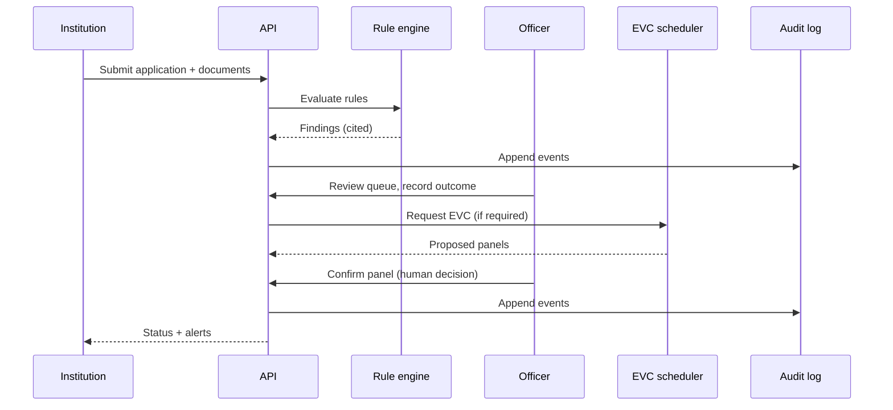
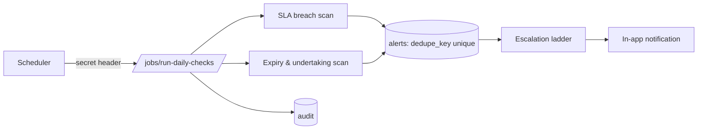

# Data Flow

## Case lifecycle

## Data stores and what flows into them
| Store | Written by | Read by | Notes |
|---|---|---|---|
| PostgreSQL | All services | All services, analytics | Source of truth; UTC timestamps |
| Object storage | Document upload | Officer view, OCR worker | Private; path + SHA-256 only in DB |
| Redis | Scheduler, rate limiter | Worker | Locks and rate counters; **not** a source of truth |
| Audit chain | Every state change | Auditor, verify endpoint | Append-only |

## Event log for process mining
`stage_history` rows (`application_id, stage, entered_at, exited_at, outcome`) are exported to the pm4py format (case ID, activity, timestamp). One row per stage visit, so rework loops appear as repeated activities.

## Daily-check data flow

## Data classification
| Class | Examples | Handling |
|---|---|---|
| Synthetic institutional data | Names, regions, intake | Free to share in demo |
| Documents | PDFs, scans | Private storage, hashed, never executed |
| Secrets | JWT key, DB password, signing key | Env / secret manager only |
| Audit data | Hash chain | Append-only |
