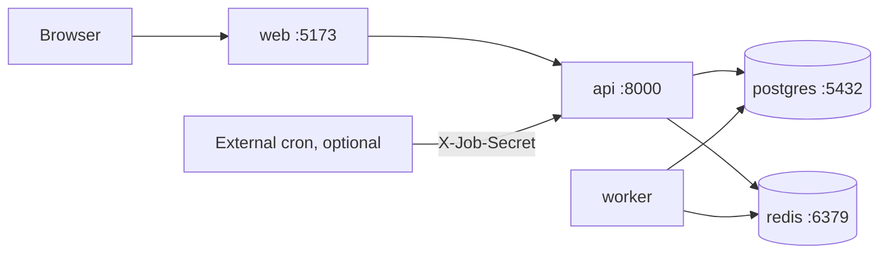

# Deployment

## Demo topology


## `docker-compose.yml` (starter)
```yaml
services:
  postgres:
    image: postgres:16
    environment:
      POSTGRES_DB: approvaliq
      POSTGRES_USER: app
      POSTGRES_PASSWORD: ${POSTGRES_PASSWORD}
    volumes: [pgdata:/var/lib/postgresql/data]
    healthcheck:
      test: ["CMD-SHELL", "pg_isready -U app -d approvaliq"]
      interval: 5s
      retries: 10
  redis:
    image: redis:7
  api:
    build: ./backend
    env_file: .env
    depends_on:
      postgres: { condition: service_healthy }
      redis: { condition: service_started }
    ports: ["8000:8000"]
    volumes: [docs_storage:/data/documents]
  worker:
    build: ./backend
    command: python -m app.core.worker
    env_file: .env
    depends_on: [api]
  web:
    build: ./frontend
    ports: ["5173:80"]
    depends_on: [api]
volumes:
  pgdata:
  docs_storage:
```

## Steps
```bash
cp .env.example .env                 # fill values; never commit
docker compose up --build -d
docker compose exec api alembic upgrade head      # or run SQL migrations
docker compose exec api python scripts/seed.py    # synthetic data only
```
Open web at `http://localhost:5173`, API docs at `http://localhost:8000/docs` (dev/demo only).

## Hosting options
| Option | Notes |
|---|---|
| Local laptop | Most reliable for a live demo |
| Single VM (free-tier cloud) | Keep TLS in front (Caddy / nginx) |
| Managed Postgres + container host | Free tiers may sleep → use external cron for the daily job |

## Scheduler on sleeping hosts
If the host sleeps, call `POST /api/v1/jobs/run-daily-checks` with the `X-Job-Secret` header from an external cron. Idempotency makes retries safe.

## Pre-demo checklist
- [ ] `docker compose up` works from a clean clone
- [ ] Seeded data loaded; "SYNTHETIC" banner visible
- [ ] Demo logins work; passwords are not real
- [ ] OpenAPI docs disabled in the public demo
- [ ] TLS on any public URL
- [ ] Backup recorded video available
- [ ] Offline fallback: local run on the presenting laptop

## Backup and restore
```bash
docker compose exec postgres pg_dump -U app approvaliq > backup.sql
docker compose exec -T postgres psql -U app approvaliq < backup.sql
```

## Rollback
Migrations are forward-only; keep a DB dump before each deploy. Roll back code by redeploying the previous image tag.
