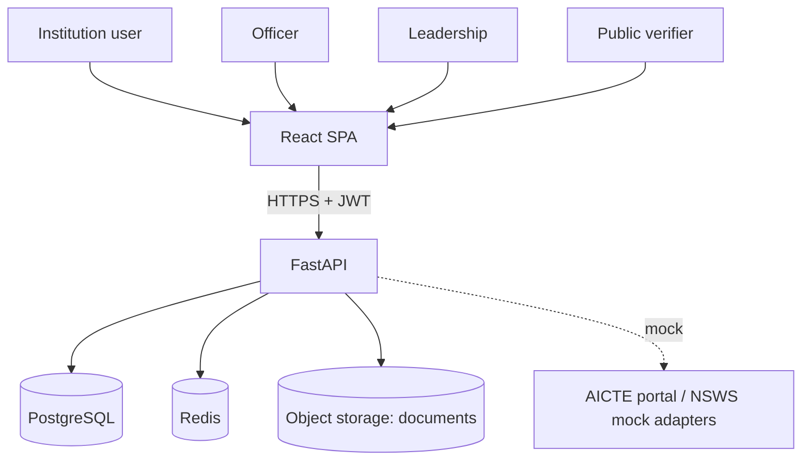
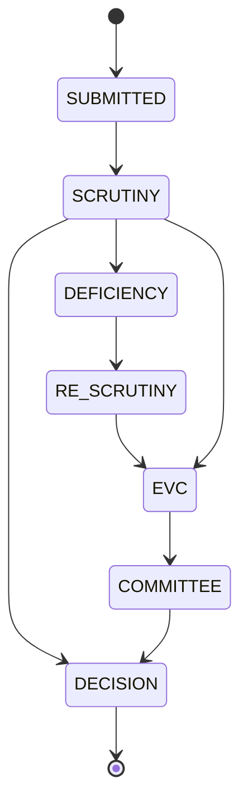

# System Architecture

## Context

## Components
| Component | Responsibility |
|---|---|
| **React SPA** | Role-based dashboards, case view, EVC calendar, simulator UI, public verify page |
| **API (FastAPI)** | AuthN/Z, REST endpoints, validation, orchestration |
| **Workflow service** | State machine, transitions, owner assignment |
| **Rule service** | Load versioned rules, evaluate, store findings |
| **EVC service** | CP-SAT scheduling with constraints |
| **Obligation service** | Dependency-graph queries |
| **Analytics service** | Process mining, bottlenecks, simulation |
| **Credential service** | Sign/verify records, revocation list |
| **Alert service** | Dedupe, escalation, notification |
| **Audit service** | Append-only hash chain |
| **Scheduler / worker** | Daily and hourly jobs (APScheduler or external cron) |
| **Adapters** (`integrations/`) | Interfaces with **mock** implementations for AICTE / NSWS |

## Layering rule
`api/` (routing, auth, validation) → `services/` (business logic) → `models/` (persistence). Services never import from `api/`. Every state-changing service call appends to the audit chain in the **same DB transaction**.

## Request path
1. JWT validated → user + role + scope (region / institution) loaded.
2. Pydantic validates input.
3. Service enforces scope **again** at query level.
4. Transaction: change + audit entry (+ alert rows, idempotent).
5. Response; errors use `{code, message, details}`.

## Workflow state machine (placeholder stages, configurable)

Stages are rows in `workflow_stages`; verify categories (new institution, EoA, etc.) against the APH before the demo.

## Non-functional targets *(measure, don't assume)*
| Aspect | Target | Measured |
|---|---|---|
| p95 API latency (list endpoints) | TBD | — |
| Daily job on 10k synthetic cases | TBD | — |
| Rule evaluation per case | TBD | — |

## Failure behaviour
- Drafts cached client-side; submission requires connectivity.
- Rule or extraction failure **never auto-rejects**; the case routes to manual review.
- Solver timeout falls back to an earliest-deadline-first heuristic.
- Redis down: jobs fall back to DB-based locking; alerts remain idempotent through the unique `dedupe_key`.
