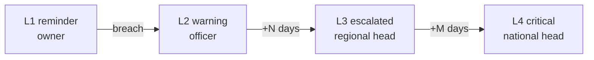

# Alerts & Escalation (C7)

## Purpose
Turn conditions (SLA, expiry, overdue, unstaffed EVC) into **deduplicated** notifications that escalate predictably and are auditable.

## Escalation ladder (placeholder timings)

Levels, delays and recipients come from configuration (`CONFIGURATION.md`).

## Creation
```sql
INSERT INTO alerts (entity_type, entity_id, rule_code, level, message, recipient_role, dedupe_key)
VALUES (...)
ON CONFLICT (dedupe_key) DO NOTHING;
```
Dedupe key: `<rule_code>:<entity_type>:<entity_id>:<level>:<window>` (see `ALERT_SCHEMA.md`).

## Job
`POST /jobs/run-daily-checks` (secret header):
1. Acquire an advisory lock (skip if another run is active).
2. Run SLA scan, expiry scan, undertaking scan, EVC-unstaffed scan.
3. Create alerts idempotently; escalate by comparing breach age with the ladder.
4. Write a job-summary audit entry (counts only).

## Acknowledgement
`POST /alerts/{id}/ack` records who and when. Acknowledging does not clear the underlying condition; escalation continues unless the condition resolves.

## Notification channels
Prototype: in-app only. Email/SMS are mock adapters behind `integrations/notifier.py` (future work).

## Tests
- Run the job twice → 0 new alerts on the second run.
- Escalation level increases at configured ages, only once per level.
- Alerts visible only within the recipient's scope.
