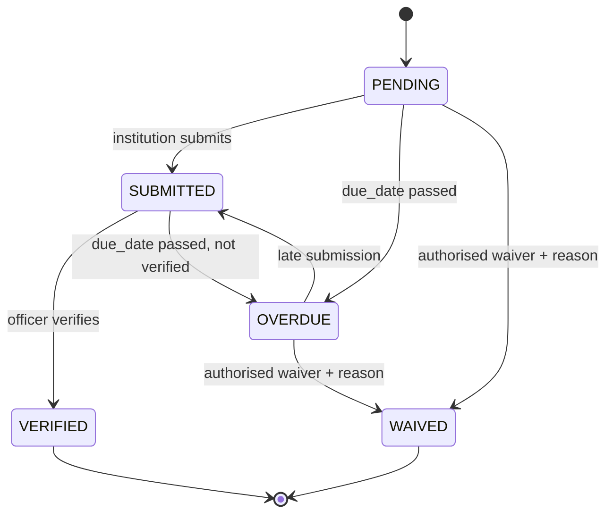

# Undertakings & Document Validity (C5, C6)

## Undertakings lifecycle

- Created when a decision is conditional (or manually by an officer).
- `OVERDUE` is set by the daily job, never by hand.
- `WAIVED` requires `waiver_reason` and an authorised role; audited.

## Document validity (e.g. lease, NOC)
- `documents.valid_until` drives reminders at configured offsets (e.g. T-30, T-7, T-1).
- Expiry of a document marks dependent obligations "at risk" (see `OBLIGATION_GRAPH.md`).
- Required minimum validity for specific document types is a **rule** (e.g. `R-DOC-LEASE-VALIDITY`), not hard-coded.

## Daily job steps
1. Select undertakings with `due_date < today` and status in (PENDING, SUBMITTED) → set OVERDUE, create alert + escalate.
2. Select documents whose `valid_until − today` matches an offset → create reminder alerts (dedupe key includes offset).
3. Write one audit entry per state change.

## Tests
- Each status transition allowed/forbidden matrix.
- Reminders fire once per offset; second job run adds none.
- Waiver without reason → 400.
- Region scoping applies to every list.
