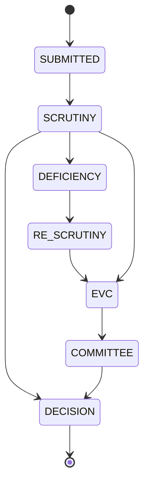

# Workflow Engine (C1)

## Purpose
Move each application through configurable stages with role-gated, validated transitions, recording every visit as an event for SLA tracking and process mining.

## State machine (placeholder stages; configurable)

> Verify stages and routes per application category against the APH before the demo. Different categories (new institution, EoA, intake increase, new course) may use different routes defined in `routes.yaml`.

## Data
`workflow_stages(code, stage_order, sla_days, owner_role, next_stages[])`, `applications.stage`, `stage_history` (one open row per application, enforced by a partial unique index).

## Rules
1. A transition is allowed only if `to_stage ∈ current.next_stages`.
2. The caller's role must match the stage's `owner_role` (or be a supervising head).
3. Closing the old stage row and opening the new one happen in one transaction with the audit entry.
4. A **decision** is a separate human action (`/decision`), not a side effect of a move or a finding.
5. Illegal transitions return `409 INVALID_TRANSITION` with the allowed targets in `details`.

## Inputs / outputs
| | |
|---|---|
| Input | `application_id`, `to_stage`, optional `outcome`, `note` |
| Output | Updated application, new `stage_history` row, audit entry |
| Errors | `INVALID_TRANSITION`, `FORBIDDEN`, `OUT_OF_SCOPE` |

## Edge cases
- Concurrent moves: lock the application row (`FOR UPDATE`); the second request sees the new stage and fails validation.
- Re-scrutiny loops: allowed, but each loop is counted (feeds D1).
- Stage config change while cases are open: new SLAs apply to **new** stage entries only.

## Tests
- Every allowed edge passes; every disallowed edge returns 409 (parametrised over the full matrix).
- Wrong role → 403.
- Two simultaneous moves → exactly one succeeds.
- Each move yields exactly one open `stage_history` row.
